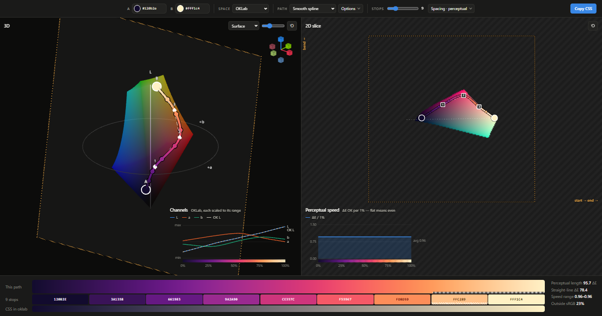

# Gradient Paths

**[Open the live app →](https://gradientpaths.shinjipons.com)**

An interactive gradient generator that treats a gradient as a path through color space. Pick two colors, pick a space (OKLab, OKLCH, CIELAB, LCh, HSL, HSV or sRGB), then bend the route between them with arcs, Bézier curves or splines. Space the stops evenly by perceived difference and copy the CSS.

[](https://gradientpaths.shinjipons.com/#a=120b2e&b=fff1c4&s=oklab&m=spline&h=shorter&p=0.344,-0.293,-0.126;0.498,0.082,0.265;0.227,0.278,0.558&ab=0.35&ar=0&n=9&sp=perceptual&e=linear)

*Above: "Night to sunrise", a smooth OKLab spline through plum, magenta and coral, with perceptually even stops. A plain two-stop gradient between the same colors goes through a dull mauve. [Open it](https://gradientpaths.shinjipons.com/#a=120b2e&b=fff1c4&s=oklab&m=spline&h=shorter&p=0.344,-0.293,-0.126;0.498,0.082,0.265;0.227,0.278,0.558&ab=0.35&ar=0&n=9&sp=perceptual&e=linear).*

## What's in it

- **Color spaces:** sRGB, linear sRGB, HSL (cylinder), HSV (cone), OKLab, OKLCH, CIELAB, CIE LCh. Each space defines its own conversions, plus an *embedding*: a Cartesian, Z-up frame (`src/color/spaces.ts`) where the curves are built and drawn.
- **Path shapes** (`src/path/paths.ts`):
  - native per-channel interpolation, which is what CSS `in <space>` does, with hue direction
  - a straight line
  - an orbit around the gray axis
  - a circular arc (bend and roll)
  - quadratic and cubic Béziers
  - a polyline through waypoints
  - a centripetal Catmull–Rom spline
- **Sampling:** stops can be spaced by the curve parameter, by distance in the space, or by perceptual distance (OKLab ΔE). Easing goes on top. Colors outside sRGB are clipped, and flagged on the path and on any stop they reach.
- **Views:**
  - 3D: the sRGB gamut as a surface, point cloud or wireframe, with the path through it, in orthographic projection
  - 2D slice: the plane the path bends in, with draggable handles
  - channel and perceptual-speed charts
  - a CSS output, and the browser's own interpolation next to it for comparison

The URL hash holds the current state, so you can share a link to it.

## Navigation

**3D view.** Middle-drag to pan, or right-drag to orbit. Shift swaps the two (Shift+middle orbits, Shift+right pans), and Ctrl dollies. Use the wheel or a pinch to zoom toward the cursor, and a two-finger drag to orbit. The left button never moves the camera: click a handle to select it, then drag the gizmo's arrows. The axis widget in the top-right corner snaps to a view along any axis when you click one of its ends, and orbits when you drag it.

**2D slice.** Drag a handle to move it; hold Shift to lock the move horizontally or vertically. Drag empty space, or right- or middle-drag, to pan. Use the wheel or a pinch to zoom.

## Development

```bash
npm install
npm run dev
```

Built with TypeScript, [three.js](https://threejs.org) and [Vite](https://vitejs.dev).
